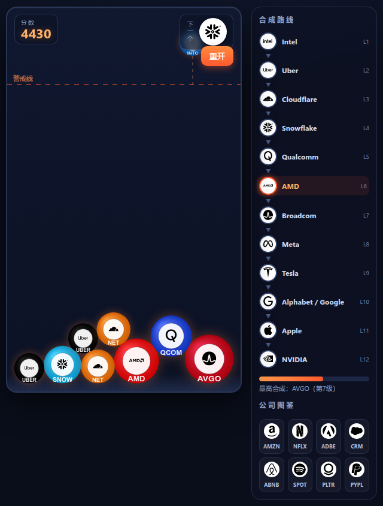
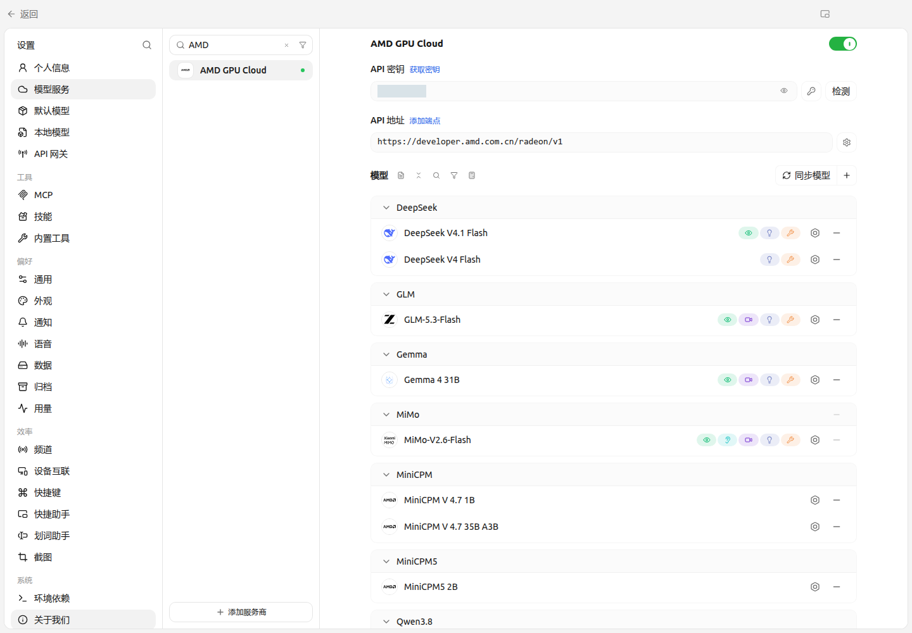
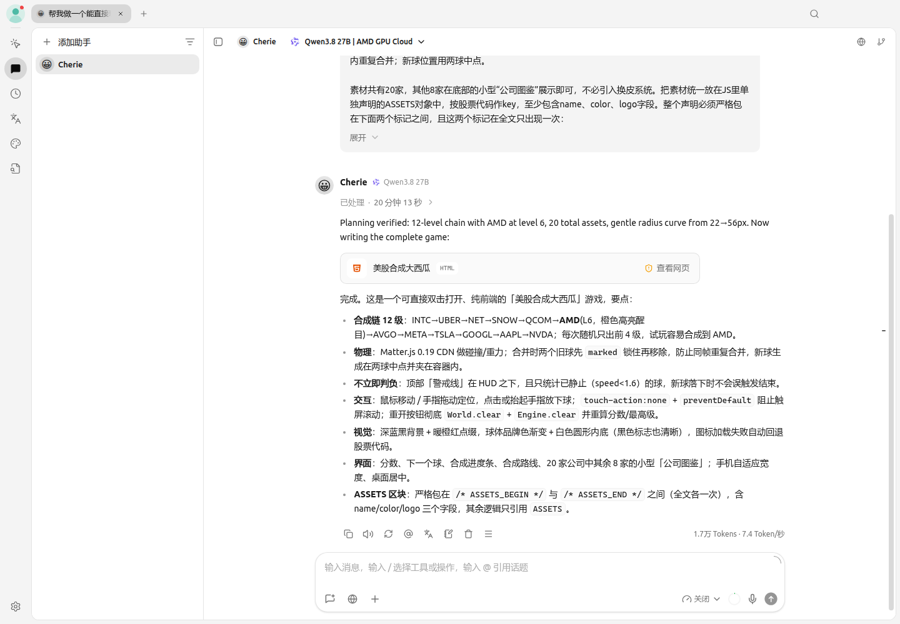

# 每天10美元免费额度，我在Cherry Studio里用AMD模型搓了个“美股合成大西瓜”

平时在电脑上用Cherry Studio调大模型的人不少。最近升到2.2.2版本，我发现它的服务商列表里已经内置了AMD GPU Cloud，连API地址都默认配好了。填个Key就能免费调DeepSeek V4.1 Flash、Qwen3.8 27B、GLM-5.3-Flash这十来个开源模型。大显存显卡？不需要；本地推理部署？也不需要。

更香的是，走Cherry Studio内置的合作入口过去领Key，[AMD官方合作介绍](https://zhuanlan.zhihu.com/p/2076790917604950264)里给的是每日10美元免费API额度，具体到账和剩余用量在后台用量页就能查到。

光拿来聊天有点浪费，我干脆让里面的Qwen3.8 27B帮我搓了个单网页的“美股合成大西瓜”，先看跑出来的效果。



玩法大家都很熟，只不过掉下来的不是水果，换成了美股科技公司的圆球。从第1级的Intel开始往下掉，两个一样的撞一起往上升一级，第6级合出橙红高亮的AMD，再往上还能继续合Broadcom、Apple和NVIDIA。整个游戏就是一个独立的HTML文件，浏览器双击就能玩。

## 装好Cherry Studio，三分钟把AMD模型接进来

Cherry Studio是开源项目，直接去[Cherry Studio官方GitHub仓库](https://github.com/CherryHQ/cherry-studio/releases)下载安装包就行，Windows、macOS、Linux都有正式版。版本号得在2.2.2及以上，老版本的服务商列表里还没有内置AMD入口，之前装过的升个级就好。

打开软件后，新装的引导页选“配置其他服务商”，老用户点左下角齿轮进“设置”，在“模型服务”上方的搜索框里搜AMD，就能看到内置好的AMD GPU Cloud。点开会发现API地址已经默认填好了`https://developer.amd.com.cn/radeon/v1`，不用手改。

PS：如果你在[Token Factory官方文档](https://amd-aim.github.io/radeon-cloud-docs/zh-cn/guides/token-factory/)里看到带`/radeon/api/v1`的路径也不用纠结，两边是官方兼容的同一套接口，留着Cherry默认的就行。

接下来拿Key。点API密钥上方的蓝字“获取密钥”，浏览器会带着Cherry的合作渠道参数跳到Radeon Cloud的Token Factory页面。之前没注册过AMD开发者账号的话，先走一遍[注册入口](https://developer.amd.com.cn/login?source=8EHcpUKwn)就行。详细步骤我们之前在[Radeon Cloud入门篇](https://www.zhihu.com/question/539158346/answer/2071287480968536065)写过，这里不重复了。

在Token Factory页面生成并复制好自己的API Key，回到Cherry粘进密钥框里，点一下右边的“检测”确认连通，再看一眼右上角的绿色总开关是不是开着的。

往下点“同步模型”，列表一下子就会拉出12个模型。DeepSeek V4.1 Flash、Qwen3.8 27B、GLM-5.3-Flash、Gemma 4 31B、MiMo-V2.6-Flash，还有能看图的MiniCPM V 4.7系列都在里面，全部加进来备着就好。



配好以后点最左边栏的“对话”图标新建会话，在顶部模型菜单里选上带`AMD GPU Cloud`后缀的模型。我这次写小游戏选的是`Qwen3.8 27B`。

这里有个省时间的细节：要是赶上高峰期某个模型提示繁忙，随手切列表里另一个通用模型也能接着跑，同一个Key全通用。

## 丢一段提示词，把水果换成美股巨头

拿大模型做这种互动小玩具，最省心的路子就是让它只输出一个HTML文件。物理引擎可以调用现成的Matter.js，样式和碰撞逻辑全写在同一份文件里，类似装Node环境、部署后端这些都不需要。生成完在Cherry对话里点开就能玩，存下来发给朋友，双击浏览器也就跑起来了。

题材我挑了大家眼熟的20家美股科技公司。要是硬排成20级合成链，玩到手酸也合不到头，所以我把主合成路线定成了12级。从第1级的Intel起步，经过Uber、Cloudflare、Snowflake、Qualcomm，第6级合出橙红高亮的AMD，再往上走是Broadcom、Meta、Tesla、Google、Apple，第12级放了NVIDIA。每次随机掉前4级的小球，随便玩几分钟就能合出AMD。剩下Amazon、Netflix、Palantir那8家放在底部的“公司图鉴”里露个脸。

（PS：这套顺序纯粹是按游戏合成节奏排的，可不对应实时市值排名啊。）

至于球面上的公司标志，开源图标库Simple Icons里就有现成的SVG。我在提示词里直接给了它的公开图标目录规则，规定统一收在一个`ASSETS`对象里引用，让模型自己按需拼链接，专心写物理碰撞和界面交互。

发给`Qwen3.8 27B`的完整提示词直接贴在下面，想自己跑一版或者换成别的题材，复制过去就能用。

```text
帮我做一个能直接玩的“美股合成大西瓜”小游戏。请只输出完整HTML代码，不要写项目说明，不需要安装、构建或后端。可以通过CDN使用Matter.js做物理碰撞，其余CSS和JS放在同一HTML里。

玩法：鼠标或手指移动决定位置，点击/触摸放下圆球；同级碰撞合成下一级；有分数、下一个球、合成进度、重开按钮和明确的结束状态。刚出生或刚合成的新球在1.5秒内不触发顶部越线失败，留出落下时间。重开后必须彻底清空旧球和旧分数。拖动触屏时不要滚动页面。

视觉：深蓝黑背景，温暖的橙红点缀，圆球里展示公司图标，白色圆形内底让黑色标志也看得清；界面要干净、像完成度较高的手机休闲游戏。游戏区域宽度适配手机，桌面上居中，手机窄屏时游戏区域排在最上方，合成路线与图鉴排在下方。不要金融行情、登录、支付，也不要宣称市值排名。

默认合成链共12级，按这个顺序：INTC、UBER、NET、SNOW、QCOM、AMD、AVGO、META、TSLA、GOOGL、AAPL、NVDA。AMD在第6级，图标和名称要醒目。每次随机生成前4级，让试玩时容易合成到AMD。12级球体半径在22px到56px之间线性均匀增长，最大球能留在容器里。合并时锁住两个旧球，避免同一球在一帧内重复合并；新球位置用两球中点。

素材共有20家，其他8家在底部的小型“公司图鉴”展示即可（图鉴也加白色内底保证黑色标志清晰）。把素材统一放在JS里单独声明的ASSETS对象中，按股票代码作key，包含name、color、logo字段；图片加载失败时自动回退显示股票代码。图标地址都在https://raw.githubusercontent.com/simple-icons/simple-icons/develop/icons/<goal_company_name>.svg 下面，按需寻找即可。

参考案例如下：
找AMD: https://raw.githubusercontent.com/simple-icons/simple-icons/develop/icons/amd.svg

请把主要交互做完整，优先稳定可玩。只返回一个完整HTML代码块。
```

发出去以后等它往外吐代码就行。一整套物理碰撞、计分面板加上20家公司的配置，完整输出有8600多token。如果你也让它一次性写大几百行的网页，看到它在慢慢输出不用急着关，泡杯茶回来差不多就写完了。

等代码全部吐完，Cherry的回复气泡会把代码折叠成一个“美股合成大西瓜”的HTML卡片，点进去就能直接试玩，也可以把代码保存成单个HTML文件在浏览器里打开。



## 还能怎么玩

做这种单页小东西反馈很快，点两下就能看到实际效果，想改规则或者换套图标接着在对话里提要求就行，没什么包袱。除了搓小游戏，Cherry里同步出来的这12个模型日常都挺实用，比如写代码利索的`DeepSeek V4.1 Flash`，还有能丢截图进去问答的`MiniCPM V 4.7`，拿来做个交互图表、算账计算器、活动抽签页或者改改手头脚本都很趁手。每天10美元的免费API额度摆在那，足够平时随便折腾了。

如果把这款合成大西瓜换一套皮，你最想拿来合成什么？历代显卡天梯、车标，还是群友的表情包？欢迎评论区聊聊。

## 参考资料

- [Cherry Studio官方仓库与下载](https://github.com/CherryHQ/cherry-studio/releases)
- [AMD × Cherry Studio官方合作介绍](https://zhuanlan.zhihu.com/p/2076790917604950264)
- [AMD开发者计划注册入口](https://developer.amd.com.cn/login?source=8EHcpUKwn)
- [Radeon Cloud Token Factory官方文档](https://amd-aim.github.io/radeon-cloud-docs/zh-cn/guides/token-factory/)
- [Radeon Cloud云算力领取与入门指南](https://www.zhihu.com/question/539158346/answer/2071287480968536065)
- [Simple Icons开源图标库](https://github.com/simple-icons/simple-icons)
- [Matter.js 2D物理引擎](https://github.com/liabru/matter-js)

#AMD #CherryStudio #RadeonCloud #TokenFactory #大模型API #Qwen
