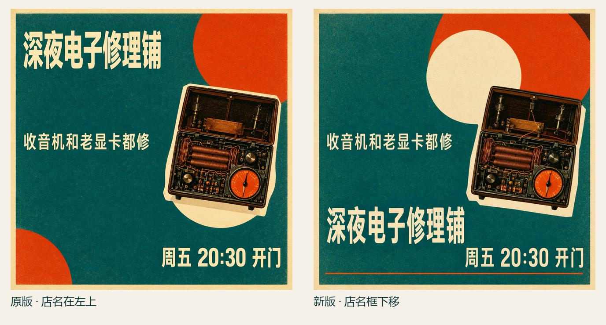
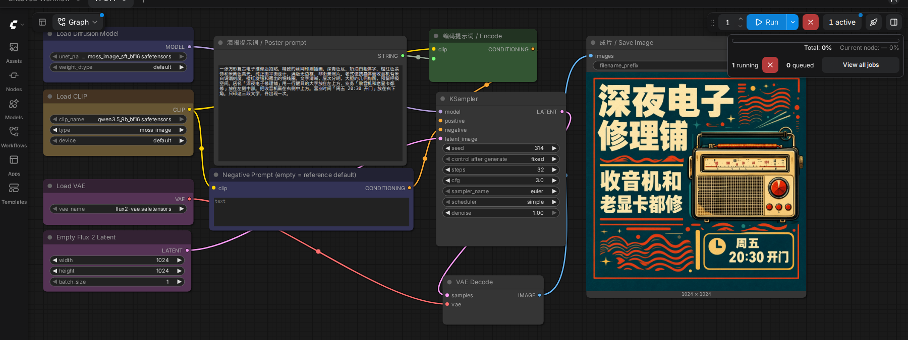
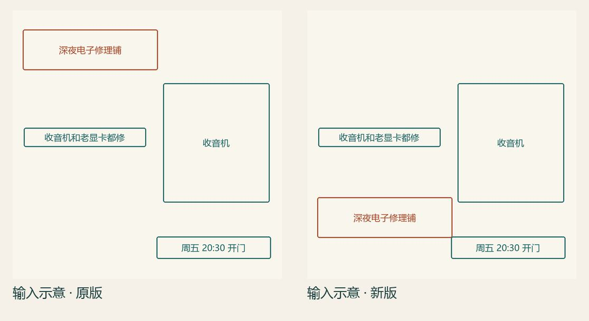

# MOSS-Image上手实测，在ComfyUI里用JSON坐标框控制海报排版

现在能写对汉字的开源文生图模型已经不少了，像我们之前测过的Qwen-Image-2.1，单张中文海报的出图质量就挺不错。

不过真拿文生图模型做实用海报时，很容易碰到一个头疼的问题，你很难锁住整张图的布局结构，也办法对局部位置做精确调整。例如，提示词里写明“标题放一行”，它经常自己折成两行；想把左上角的标题挪到左下角腾出一块空位，改完提示词重跑，原本画得好好的其他区域可能跟着全乱了。

复旦和上海创智学院等机构的OpenMOSS团队近期开源了[MOSS-Image](https://github.com/OpenMOSS/MOSS-Image)（Apache-2.0协议），刚好针对这个痛点做了一套挺有意思的架构设计。传统的生图模型多用CLIP这类编码器读提示词，对长段中文和复杂位置关系理解有限；MOSS-Image直接拿9B参数的Qwen3.5大语言模型做文本编码器，并且在训练5B单流DiT主干时，把结构化的坐标布局也放进了同一条文本输入通路里。因为语言模型本身就能读懂JSON结构，所以除了写自然语言描述，你还可以直接传一份带`bbox`坐标框的JSON给它，明确指定哪块区域写什么字、哪块区域画什么物体。

## 挪动一个坐标框的实际效果

我在Radeon Cloud的48G显存云端环境里，用ComfyUI跑了它的精调版[MOSS-Image-SFT](https://huggingface.co/OpenMOSS-Team/MOSS-Image-SFT)，试着做了一张复古风格的“深夜电子修理铺”海报。



左边是按初始JSON坐标框生成的图。右边没有改任何内容（包括随机seed），只把店名那个框的纵坐标参数往下移了640像素。看效果：左上角立刻留出了干净的空位，店名移到了左下角，副标题、右下角的营业时间和右侧的收音机都还待在各自原本规定的区域里。

## 在ComfyUI里搭好运行环境

想自己动手试的话，ComfyUI从v0.45.0版本开始已经原生支持MOSS-Image，不用额外装第三方自定义节点。

### 三份权重的作用与环境准备

跑通这套流程需要从HuggingFace的`Comfy-Org/MOSS-Image`仓库下载三份`bf16`权重，刚好对应模型生图的三个阶段。

- `qwen3.5_9b_bf16.safetensors`（约19.3GB），文本编码器，负责读懂我们输入的中文描述或JSON坐标，把文字信息转成特征向量。因为本身是个完整的9B语言模型，它在三个文件里体积最大。
- `moss_image_sft_bf16.safetensors`（约10.2GB），5B参数的单流DiT扩散主干。它把Qwen3.5传过来的文本特征和图像块放在同一条序列里做联合注意力，一步步去噪生成压缩后的潜空间图像（Latent）。
- `flux2-vae.safetensors`（约0.34GB），图像解码器。扩散主干不在大分辨率像素图上直接硬算，算完的潜空间结果最后由它解码还原成我们看到的像素图片。

三份全精度权重加起来接近30GB，跑起来显存占用在28GB左右。在Radeon Cloud上开一台48G显存的AMD GPU实例来跑的话，不用折腾量化就能全量装进显存。（PS：还没有领过免费云算力的话，可以参考我们之前的[Radeon Cloud入门篇](https://www.zhihu.com/question/539158346/answer/2071287480968536065)。）

环境搭建的核心操作就三步。先拉取ComfyUI v0.45.0并装好依赖。

```bash
git clone --branch v0.45.0 --depth 1 https://github.com/Comfy-Org/ComfyUI.git
cd ComfyUI && pip install -r requirements.txt
```

接着从`Comfy-Org`仓库把上面那三份权重下到对应的`models`子目录里。

```bash
huggingface-cli download Comfy-Org/MOSS-Image \
  --include "diffusion_models/moss_image_sft_bf16.safetensors" \
  --include "text_encoders/qwen3.5_9b_bf16.safetensors" \
  --include "vae/flux2-vae.safetensors" \
  --local-dir ./models
```

最后启动ComfyUI服务就行。

```bash
python main.py --listen 0.0.0.0 --port 8188
```

### 基础工作流配置

打开ComfyUI页面，搭出下面这个10节点的基础工作流就好，用到的全是内置节点。



左边三个加载器分别选上刚才下载的三份权重，其中`Load CLIP`里的`type`选`moss_image`。画布尺寸设成`1024×1024`，`KSampler`用`32`步、`euler`采样器配`simple`调度、`CFG 3.0`，负面提示词留空。图里的提示词没有填在编码器自带的输入框里，我单独拉了一个`PrimitiveStringMultiline`（多行字符串）节点连过去，这样后面换成带大量花括号`{}`的JSON时，不会被编码器默认的动态提示词语法误解析掉。

点`Run`跑第一张图的时候要先往显存里加载近30GB的模型，我等了一分四十多秒；模型进显存以后，后面每跑一张图基本都在90秒左右。

## 自然语言和JSON坐标框的实测对比

环境跑通之后，正好可以对比看看普通中文描述和JSON坐标框在实际排版时差在哪。

### 先用普通中文提示词试水

我们先按平时玩文生图的习惯，不动坐标，只写一段详细的中文提示词进去，把画面风格、三段文字内容和各自的大致方位都交代清楚。

```text
一张方形复古电子维修店招贴，精致的丝网印刷插画，深青色底、奶油白粗体字、橙红色装饰和米黄色高光。纯正面平面设计，满版无边框，非街景照片。老式便携晶体管收音机有米白调谐刻度、橙红旋钮和露出的铜线圈。文字清晰，层次分明，大胆的几何构图，预留呼吸空间。店名“深夜电子修理铺”用一行醒目的大字放在左上方，业务“收音机和老显卡都修”放在左侧中部。把收音机画在右侧中上方。营业时间“周五 20:30 开门”放在右下角。只印这三段文字，各出现一次。
```


出来的复古丝网印刷质感很地道，收音机的调谐刻度盘、喇叭网还有右下角的小钟图标都画得很细致，三段汉字也没出错。不过对照提示词看就会发现，里面明明写了店名“用一行醒目的大字放在左上方”，它还是自己做主把“深夜电子修理铺”折成了两行。

### 只改方位词很难管住局部和留白

如果这时候想改一版，把左上角空出来贴别的通知、让店名挪到左下角去，只改中文里的方位词行不行？我们固定同一个随机种子（314），把上面提示词里的“左上方”改成“左下方”重跑了一次。


店名确实挪到了左下角，但模型似乎见不得左上角空着，擅自塞进去一整排根本没要求过的拉丁字母，顺带把中间那句“收音机”也写错成了“收音只”。单靠自然语言去调局部位置，往往改了东边乱了西边，尤其很难让它老老实实留白。

### 换用JSON坐标框固定布局

碰到这种几块信息各归其位、某块区域需要留空的场景，切到JSON布局就顺手多了。我们把画面划分成四个框，三个放文字，一个放右侧的收音机。下图左边是初始排法，右边是把店名框往下挪之后的位置。



填进多行字符串节点的完整JSON如下。

```json
{
  "summary": {
    "meta": ["poster"],
    "canvas": "single",
    "caption": "A square 1970s silkscreen poster, petrol teal, cream and vermilion on grainy paper. Chinese lettering and one vintage transistor radio with its back open, copper coils and an orange dial. Only three lines of printed information: 深夜电子修理铺, 收音机和老显卡都修, 周五 20:30 开门. All lettering exactly once. Rich geometric shapes and areas of quiet unprinted teal."
  },
  "items": [
    {
      "label": "text",
      "caption": "bold cream Chinese display type",
      "text": "深夜电子修理铺",
      "bbox": [-440, -474, -285, 40]
    },
    {
      "label": "text",
      "caption": "smaller ivory Chinese type",
      "text": "收音机和老显卡都修",
      "bbox": [-65, -470, 8, -5]
    },
    {
      "label": "text",
      "caption": "ivory block type",
      "text": "周五 20:30 开门",
      "bbox": [350, 35, 435, 470]
    },
    {
      "label": "object",
      "caption": "cutaway vintage transistor radio with an orange tuning dial and copper coils",
      "bbox": [-235, 60, 220, 465]
    }
  ],
  "bbox_coord_space": "abs_centralized",
  "bbox_format": "yxyx"
}
```

里面的坐标规则很直观。`abs_centralized`代表以画布正中心为`(0, 0)`原点，在`1024×1024`画布上，横纵坐标的范围都是`-512`到`+512`；`yxyx`表示数组里的四个数依次对应`[上, 左, 下, 右]`四个方向的像素边界。这次店名框横向给足了宽度、上下压住了高度，生成出来的第一版里，“深夜电子修理铺”七个字就排成一行了。


### 单独挪动文本框与套用模板

现在再来做刚才自然语言翻车的那个改版动作。保持随机种子314和其他所有内容不动，只把店名框的上下边界各加640，也就是从`[-440, -474, -285, 40]`改成`[200, -474, 355, 40]`，让整个框垂直往下移640像素。

跑出来的就是文章开头右边那张图。左上角干干净净留出了青色底面，没有再乱加装饰字母，店名也落到了左下角预定的框里。对比开头那两张图还能看到一个有意思的变化，右侧收音机虽然还在原处，但背景里的红白几何圆块顺着新布局重新调整了分布，把米白色大圆挪到了右上方来平衡构图，因为每次改完坐标，模型都是照着新的版式约束重新生成整幅画面。

等这四个框的位置调满意了，这份JSON本身就成了一套现成的海报模板。比如周末想换一张线下活动海报，四个`bbox`坐标一个数字都不用动，只把里面的三处文案换成“旧机交换夜”、“带上你的旧收音机”和“周六19:00入场”，再点一次`Run`就出了同版式的新图。


## 什么时候适合用坐标框

几轮试下来，两种提示词写法的分工其实很明确。刚开始摸索画面色调和插画风格的时候，随手写几句普通中文最快；等心里已经定下了版式结构，需要让主副标题和角标待在指定区域，或者拿同一套排版批量换文案出系列图时，换成JSON坐标框会省心不少。

你平时用AI生成带字海报或封面图时，最头疼哪类排版问题？欢迎评论区聊聊。

## 参考资料

- [MOSS-Image官方GitHub仓库](https://github.com/OpenMOSS/MOSS-Image)
- [MOSS-Image布局输入指南](https://github.com/OpenMOSS/MOSS-Image/blob/main/USERGUIDE.md)
- [OpenMOSS-Team/MOSS-Image-SFT模型页](https://huggingface.co/OpenMOSS-Team/MOSS-Image-SFT)
- [Comfy-Org/MOSS-Image重打包权重](https://huggingface.co/Comfy-Org/MOSS-Image)
- [Radeon Cloud云算力领取与入门指南](https://www.zhihu.com/question/539158346/answer/2071287480968536065)

#AMD #ROCm #MOSSImage #ComfyUI #RadeonCloud #AI生图
