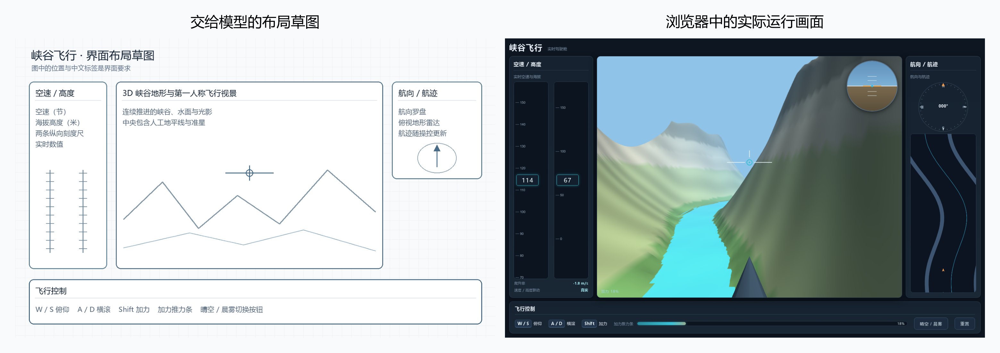
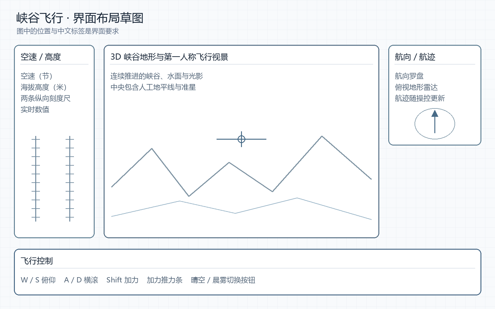
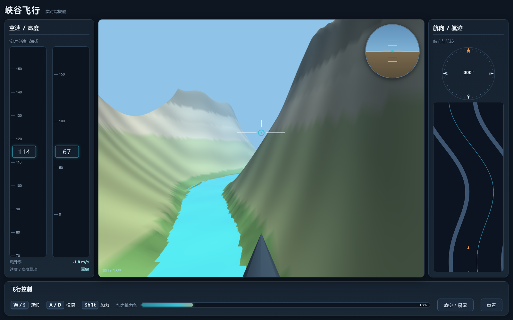
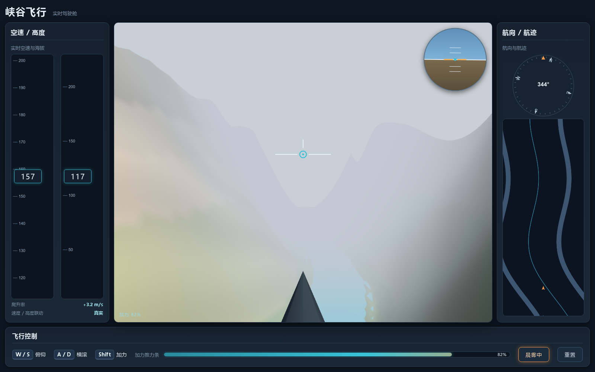

# AMD Radeon GPU实战Inkling 2 Mini

最近HuggingFace上出现了一个很火的开源模型[Inkling 2 Mini](https://huggingface.co/thinkingmachines/Inkling-2-Mini)，权重只有20GB出头，但在代码生成、视觉理解和Agent任务上的效果都很不错。Inkling 2 Mini是Thinking Machines Lab在11月20日放出的26.4B多模态稀疏MoE模型，原生支持图像和文本输入。

一般大模型想增加每个token的计算深度，通常得往上堆物理层数，模型体积也会跟着涨；Inkling 2 Mini则换成了Loop Transformer架构，只存24层物理权重，推理时让中间12层复用同一套权重循环执行3次，跑出了48层的等效计算深度。

具体推理时，这24个物理解码层被均分成4组，每组6层。每生成一个token，第0到5层先跑1次提取基础特征，然后中间的第6到17层连续循环跑3次，最后的第18到23层再跑1次完成输出，加起来正好48次层计算。

如果直接把第1轮第17层的输出塞回第6层重算，特征在同一套权重里反复变换很容易跑偏，训练也不好收敛。所以Inkling 2 Mini固定了每轮循环的起点，在Loop中三次进入第6层时，起始输入始终是第5层输出的同一份隐状态；到了第2轮和第3轮，循环层会额外从上一轮的残差输出里提取跨轮消息，再由层内的门控模块控制保留多少当前输入、融合多少上一轮算出的信息，相当于以第5层的隐状态为基准，对中间特征表示做了三次迭代更新。

物理权重虽然只存了24层，但每个token实际要经过48次层计算，这48步在推理时也都要各自存一份KV Cache。计算量上靠的是稀疏MoE结构，每层128个专家里每次只挑8个参与计算，单走一遍24层只激活3.4B参数，算上中间12层多循环的两轮，每个token的等效激活参数也就5.4B左右。KV Cache上则做了局部化处理，24个物理层里只有4层是看完整历史文本的全局注意力，其余20层都用了滑动窗口注意力，每次只看最近1024个token，不用为超长文本一直攒全量缓存。这样整套模型的运行成本一直都很克制，哪怕加上长上下文放进单张大显存显卡里，跑起来也很舒服。

## Radeon Cloud上的实测效果

我在Radeon Cloud上开了一台单卡48G显存的AMD Radeon GPU实例，用llama.cpp把这套模型跑了起来。

官方发布时演示过用文字生成飞行小网页，这次我想把它的多模态看图和长代码生成绑在一起测一测。我画了一张带中文分区说明的界面线框草图喂给模型，文字提示词里故意不提各个仪表盘摆在哪边，看它能不能自己读懂图里的版面结构，写出一个能开的3D峡谷飞行网页。

先看跑出来的实际画面。



左边是喂给模型的线框草图，右边是生成的单文件HTML在浏览器里跑起来的效果。草图里画的左侧空速与海拔刻度尺、右上角航向罗盘与俯视航迹窗、底部的飞行控制栏，在网页里都落在了对应位置，打开就能用键盘开着飞机在峡谷里穿行。

## 在Radeon Cloud搭起多模态服务

想自己动手试的话，因为Inkling 2 Mini推理时要维护中间层的Loop与跨轮状态，只按层顺序单次前向执行的旧版推理框架不支持这套计算图。这里我们选用[Unsloth构建的新版llama.cpp预编译包](https://github.com/unslothai/llama.cpp/releases/tag/b12649-mix-c7059d6)，已经适配了`inkling2_loop`架构并集成了ROCm后端，解压后就能在AMD GPU上运行推理，不需要从头编译源码。

### 两份模型文件与显存占用

跑多模态图文推理一共需要准备两个GGUF权重文件，加起来约23.5GB。

- `Inkling-2-Mini-UD-Q8_K_XL.gguf`（约22.9GB），语言和代码主模型。官方原始权重本身就是混合精度发布的，这份文件保留了每层128个MoE路由专家原有的NVFP4权重，其余层按BF16存储。
- `mmproj-F16.gguf`（约0.64GB），对应模型内置的23层ViT视觉编码器与视觉投影模块，负责把传入的图片转成主模型能处理的视觉特征。

官方最高支持1M上下文，日常拿来塞高清截图和几百行代码，把运行上下文设到32K就绰绰有余了。实测跑32K上下文的图文生成时，显存占用最高在23.3GiB左右，在Radeon Cloud上开一台单卡48G显存的Notebook实例来跑，权重和KV Cache全量装进去还留有一半余量。

PS：如果还没领过免费云算力，可以先看我们之前的[Radeon Cloud算力领取与入门指南](https://www.zhihu.com/question/539158346/answer/2071287480968536065)。

### 三步启动llama-server

打开Notebook终端建好目录，拉取适配AMD gfx110X架构的ROCm预编译包并解压。

```bash
mkdir -p inkling-demo/runtime inkling-demo/models
cd inkling-demo

curl -fL -o rocm-llama.tar.gz \
  https://github.com/unslothai/llama.cpp/releases/download/b12649-mix-c7059d6/app-b12649-mix-c7059d6-linux-x64-rocm-gfx110X.tar.gz
tar -xzf rocm-llama.tar.gz -C runtime
```

PS：如果云端终端直连GitHub Release下载较慢，也可以先下到本地电脑，再拖进JupyterLab左侧的`inkling-demo`目录里解压。

接着从HuggingFace镜像站把主权重和视觉投影模块拉下来。

```bash
curl -fL -C - -o models/Inkling-2-Mini-UD-Q8_K_XL.gguf \
  https://hf-mirror.com/unsloth/Inkling-2-Mini-GGUF/resolve/main/Inkling-2-Mini-UD-Q8_K_XL.gguf

curl -fL -C - -o models/mmproj-F16.gguf \
  https://hf-mirror.com/unsloth/Inkling-2-Mini-GGUF/resolve/main/mmproj-F16.gguf
```

最后在同一目录下启动多模态推理服务。

```bash
./runtime/llama-server \
  -m ./models/Inkling-2-Mini-UD-Q8_K_XL.gguf \
  --mmproj ./models/mmproj-F16.gguf \
  --alias inkling --jinja -ngl 99 -fa on \
  -c 32768 -n 12288 --temp 1.0 \
  --host 127.0.0.1 --port 8080
```

这里几个启动参数的作用顺带交代一下。
- `-m`和`--mmproj`分别挂载语言主模型和视觉投影模块，漏掉`--mmproj`就没法接收图片输入
- `--jinja`启用模型自带的Jinja聊天模板，多模态消息拼接和推理强度控制都靠它解析
- `-ngl 99`把模型所有层都offload到AMD GPU上，`-fa on`打开Flash Attention降低长文本显存开销
- `-c 32768`把上下文窗口设为32K，`-n 12288`放宽单次最大生成token数，避免写几百行HTML时半截断掉
- `--temp 1.0`按官方推荐配置把采样温度定在1.0，不用像调老代码模型那样特意压低温度

## 看界面布局草图生成3D飞行网页

服务跑起来之后，就可以把草图和需求喂给它了。

### 输入草图与提示词设计

下面这张图就是实际传给模型的中文布局草图。



整张图划分成了左、中、右上和底部四个线框，标清了每块放什么仪表和控件。为了验证模型是真看懂了图里的空间排布，而不是靠文字猜位置，发给它的提示词里只写了3D场景和操控要求，没有提任何模块的左右上下方位。

发给模型的第一轮完整提示词如下。

```text
请仔细读取附图中的界面区域划分、各模块摆放方位和中文标签，实现一个单文件、无后端依赖的可交互3D峡谷低空飞行仿真网页。图里的位置关系和标签都是要求，请按图安排，不要自行交换区域。

只输出一个完整HTML代码块，CSS和JavaScript都写在这一份文件里。可以从公开CDN使用固定版本的Three.js，也可以使用原生WebGL或Canvas；不要构建工具，不要依赖外部模型、贴图或音频文件。

画面要达到可直接展示的完成度：连续起伏的峡谷地形、河流水面、天空和有层次的光影，第一人称飞行时地形持续向后推进，不能只有一个旋转方块或静态背景。启动时飞机在可见地形上方，前方有清晰的峡谷与地平线，避免摄像机在山体内或完全看向天空。

按附图做齐并真实联动所有仪表：空速、高度、航向、俯视航迹和人工地平线。W/S控制俯仰，A/D控制横滚，按住Shift加力，速度和高度随着飞行变化；松开按键后操控平稳，不要一按就把视角翻到地下。给出清楚的中文操作提示。

晴空/晨雾按钮必须改变场景的雾效、天空或能见度，加力条随加力状态变化。页面布局在1600×1000和1365×900窗口下都不能互相遮挡，主视景应占最大面积。配色采用克制的深蓝灰航空仪表风格，少量青色或橙色强调，中文要清楚。网页打开即可运行，不要要求先点击开始；提供可用的重置按钮。

优先完成真实交互和稳定渲染，代码要自包含、完整且可直接保存运行。不要输出解释或省略实现。
```

### 截张运行画面让它自己把视角调正

第一轮等了小五分钟，模型吐出了四百多行HTML代码。用浏览器打开看看，一开始感觉还行，左边的空速海拔尺、右上角的罗盘与航迹小窗、底部的按键提示栏全都按草图摆在了该在的位置，深蓝灰的航空仪表味也挺正。不过中间最关键的3D主视景出了点岔子，画面里只有一片蓝天和一大截贴脸的灰机鼻，峡谷和河面影子都没见着。

要是换作以前的纯文本代码模型，这时候就得自己按F12去翻四百多行Three.js代码，一行行算相机到底朝哪边偏了。既然Inkling 2 Mini本身就能看图，我就试试把这张“蓝天配大机鼻”的浏览器运行截图存下来，连同最初的布局草图和HTML源码一块丢回给它，让它别动周围已经摆好的仪表，自己对照运行画面把中间的3D视角调出来。

三分钟后模型回了修改片段，抓出来的问题还挺准。原来第一版写相机旋转时偏航角少加了一个`Math.PI`，镜头等于背对着前进方向在飞，再加上初始高度设在230米太高、代表飞机的那个几何锥体也画太大了，视野全被挡死。此外，它也顺带揪出了河面动画的一个隐蔽bug，原本每帧更新波动都在上一帧改过的顶点横坐标上继续累加，飞一会儿整条河就飘出峡谷了。

把它给的几处修改换进去刷新浏览器，两侧起伏的峡谷山壁和底下的河道一下子就出来了。



按W/S拉起和压低机头，按A/D左右拐弯，按Shift加速就能操作，能看到左边刻度尺的速度海拔数字、主画面右上角的人工地平线，还有右侧小地图里的航迹线全都在实时跟着动。点一下右下角的天气按钮切到晨雾模式，远处的山脊和河面立刻笼上一层灰白雾气，视觉效果不错。



PS：生成代码默认从CDN拉取Three.js r128，如果本地网络连不上那个CDN导致中间画面黑屏、控制台报`THREE is not defined`，去[Three.js r128仓库](https://github.com/mrdoob/three.js/tree/r128/build)下个`three.min.js`放到HTML同级目录，把`script`标签改成本地路径就能完全离线玩了。

## 跑下来的几点体会

这轮实测跑下来，Inkling 2 Mini最实在的地方还是靠中间12层三次循环加跨轮门控换出来的显存性价比；同时23层ViT的视觉定位确实体验不错，不但能照着线框图把复杂前端布局排对，中途代码写残了，也能只靠截图反馈把画面异常和几百行代码里的坐标逻辑对应上。

自己上手折腾的话，采样温度按官方习惯留在1.0就行。遇到写长代码或者单卡部署算力不够的场景，调接口时可以试试把推理强度`reasoning_effort`压到`minimal`再留足输出上限，体验会顺畅不少。

除了看草图搭前端原型，这种“看图+读代码”的组合拿去看报错截图或者结合GPU监控曲线查代码bug也很顺手，后面我们再单独拿真实工程排障的例子来测一测。

如果在手头跑起这样一个20GB级的多模态代码模型，你最想先丢给它什么样的草图或界面试试？欢迎评论区聊聊。

## 参考资料

- [Inkling 2 Mini官方模型仓库](https://huggingface.co/thinkingmachines/Inkling-2-Mini)
- [Hugging Face Inkling 2 Mini技术解读](https://huggingface.co/blog/inkling2mini)
- [Unsloth Inkling 2 Mini GGUF权重](https://huggingface.co/unsloth/Inkling-2-Mini-GGUF)
- [Unsloth llama.cpp预编译发布页（b12649-mix-c7059d6）](https://github.com/unslothai/llama.cpp/releases/tag/b12649-mix-c7059d6)
- [Three.js r128源码仓库](https://github.com/mrdoob/three.js/tree/r128/build)
- [Radeon Cloud算力领取与入门指南](https://www.zhihu.com/question/539158346/answer/2071287480968536065)

#AMD #ROCm #RadeonCloud #Inkling2Mini #开源大模型 #llamacpp
